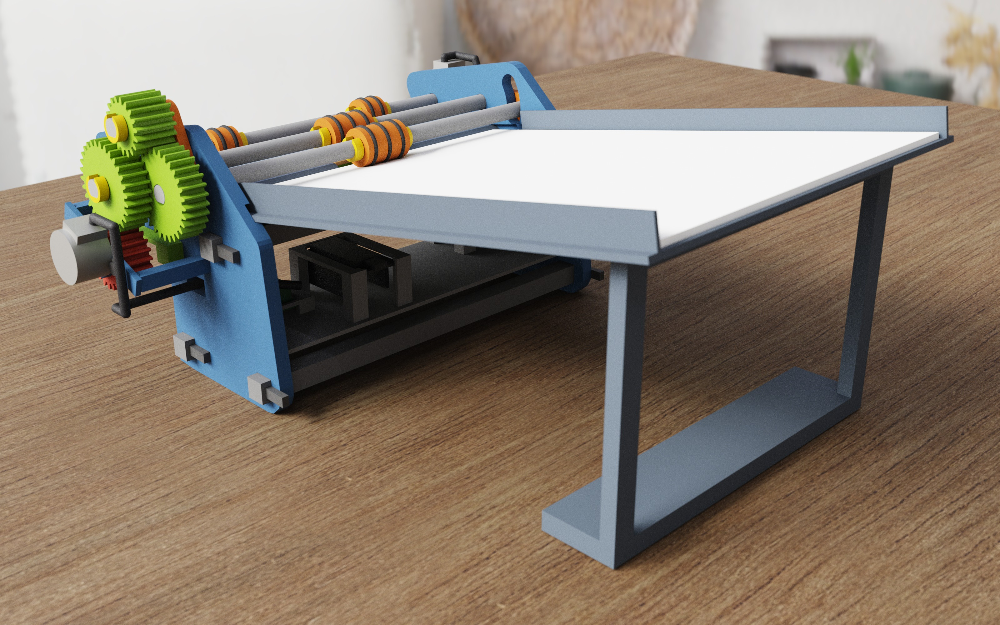

# Paperhawk sheet feeder

Lays up to 40 A4 sheets one by one, face up, into the box under Paperhawk's phone. Almost all
of it is 3D printed; the parts you buy cost about 70 €.

## Build it

1. **Buy** what is on the list below.
2. **Print** a small fit test, then the feeder: [PRINTING.md](PRINTING.md).
3. **Assemble** it in 19 steps with a picture each: [ASSEMBLY.md](ASSEMBLY.md).
4. **Wire, program and start** it: [ELECTRONICS.md](ELECTRONICS.md).

## Shopping list

| What | How many | Where | Price |
|---|---|---|---|
| 28BYJ-48 stepper motor with ULN2003 driver board | 2 (pack of 5) | [Amazon](https://www.amazon.de/dp/B07VGV1XFT) | 13,99 € |
| ESP32 DevKit board, USB-C | 1 (pack of 3) | [Amazon](https://www.amazon.de/dp/B0DBDNPZBY) | 18,58 € |
| Jumper wires female–female, 20 cm | 12 | [Amazon](https://www.amazon.de/dp/B01EV70C78) | 6,99 € |
| O-ring 19 × 2.5 mm, NBR 70 | 16 | [HUG Technik](https://www.hug-technik.com/shop/Praezisions-O-Ring--19-00-x-2-50-mm--NBR70.html) | 0,58 € each |
| PETG filament | about 100 g | [Bambu Lab](https://eu.store.bambulab.com/en/products/petg-basic) | 15,99 € |
| USB-C data cable | 1 | [Amazon](https://www.amazon.de/dp/B018GR2WS6) | 5,90 € |

Also needed: about 650 g of PLA filament, a natural wine cork, glue, and a box for the sheets
to land in, at least 320 × 220 mm inside with walls at most 60 mm high.

## Files

| File | What it is |
|---|---|
| [feeder_h2d.3mf](https://github.com/SimonDanisch/Paperhawk.jl/raw/main/hardware/feeder/parts/feeder_h2d.3mf) | All printed parts, ready to print with Bambu Studio |
| [coupon_h2d.3mf](https://github.com/SimonDanisch/Paperhawk.jl/raw/main/hardware/feeder/parts/coupon_h2d.3mf) | The fit test, printed first |
| [pad_spring_variants_h2d.3mf](https://github.com/SimonDanisch/Paperhawk.jl/raw/main/hardware/feeder/parts/pad_spring_variants_h2d.3mf) | A softer and a stiffer pad spring, only if needed |
| [feeder.ino](https://github.com/SimonDanisch/Paperhawk.jl/raw/main/hardware/feeder/firmware/feeder/feeder.ino) | The program for the ESP32 |

Clicking one of these names downloads the file. To look at single parts in 3D in the browser,
open [parts/stl](parts/stl) and click a part; [parts/step](parts/step) has them for CAD programs.

How it works, what paper it handles and how it was simulated and checked: [DESIGN.md](DESIGN.md).
